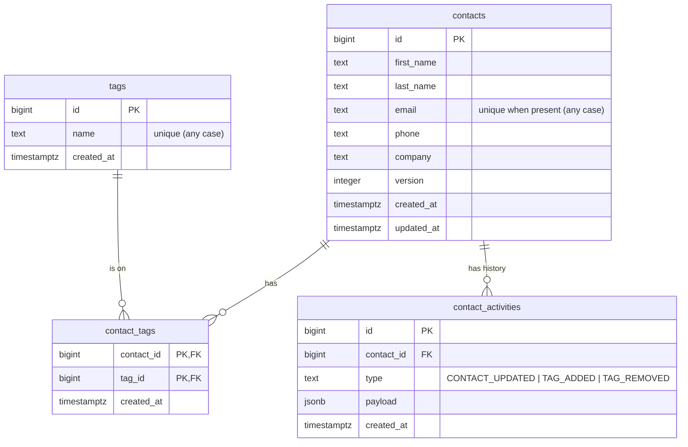

# CRM Contact Workspace

Browse, search, filter, sort and page through contacts; view and edit a contact; add and remove tags, bulk-assign a tag; and see each contact's recent activity.

## Tech stack

TypeScript everywhere, with `strict` on.

| Part | Libraries | Used for |
|---|---|---|
| **Backend** | Node 22, Express 5 | HTTP server and routing. Errors thrown in async handlers reach the error middleware without extra code. |
| | zod | Validating every request's params, query and body |
| | Kysely, pg | Type-safe SQL query builder, and the Postgres driver underneath it |
| | cors | Allowing the frontend's origin |
| | Vitest, supertest | Integration tests against a real Postgres test database |
| **Database** | PostgreSQL 16 | Data, with trigram indexes for search, a partial unique index on email, and transactions |
| | @faker-js/faker | Seed data, generated from a fixed seed so every run produces the same contacts |
| **Frontend** | React 19, Vite | UI and dev server / build |
| | React Router | The two routes: the list and the contact detail page |
| | TanStack Query | Fetching, caching and refreshing server data |
| | Headless UI | Accessible combobox, menus and dialog, styled with Tailwind |
| | Tailwind CSS | All styling, with no CSS files |
| | axios | HTTP client under the API functions |

Postgres runs in Docker locally. The hosted version runs on Render: a static site, a web service and a Postgres database.

## Database

PostgreSQL, with four tables:

| Table | What it holds |
|---|---|
| `contacts` | One row per contact. `version` is used for optimistic locking on edits. |
| `tags` | The tags that can be put on contacts (`Lead`, `VIP`, …). |
| `contact_tags` | Which contact has which tag: the many-to-many link between the two. |
| `contact_activities` | The history of each contact: edits, tags added, tags removed. |

- **`contact_tags`** links contacts and tags, many-to-many. Each row is one contact having one tag, and the primary key `(contact_id, tag_id)` stops the same tag being added twice.
- **`contact_activities`** belongs to one contact: each contact has many activity rows. A tag change copies the tag's id and name into `payload` instead of linking to `tags`, so the history still reads correctly if a tag is later renamed or deleted.



## Backend

Node 22 and Express 5 in TypeScript, with zod for validation and Kysely for SQL. Requests go through routes → controllers (validate and shape the response) → services (business rules and transactions) → repositories (SQL only).

### API

Base path `/api`. Request and response bodies are JSON, with camelCase field names.

| Method | Path | What it does | Request | Response (200) |
|---|---|---|---|---|
| GET | `/health` | Health check: runs `SELECT 1` | — | `{ "status": "ok" }` |
| GET | `/api/contacts` | List contacts: search, filter, sort, page | Query: `page`, `limit`, `sort`, `order`, `q`, `company`, `tags` | `{ data: Contact[], pagination: { page, limit, total, totalPages } }` |
| GET | `/api/contacts/:id` | One contact, with its tags | — | `Contact` |
| PATCH | `/api/contacts/:id` | Edit a contact | `{ version, firstName?, lastName?, email?, phone?, company? }` | The updated `Contact` |
| POST | `/api/contacts/:id/tags` | Add a tag to a contact | `{ tagId }` | The `Contact` |
| DELETE | `/api/contacts/:id/tags/:tagId` | Remove a tag from a contact | — | The `Contact` |
| POST | `/api/contacts/bulk/tags` | Add one tag to many contacts | `{ contactIds, tagId }` | `{ tagId, requested, added }` |
| GET | `/api/contacts/:id/activities` | The contact's recent activity, newest first | Query: `limit` | `{ data: Activity[] }` |
| GET | `/api/tags` | All tags | — | `{ data: Tag[] }` |
| GET | `/api/companies` | Company names, for the company filter's suggestions | Query: `q`, `limit` | `{ data: [{ name }] }` |

A `Contact` looks like this:

```json
{
  "id": 42,
  "firstName": "Asha",
  "lastName": "Verma",
  "email": "asha@acme.com",
  "phone": "+91 98765 43210",
  "company": "Acme",
  "tags": [{ "id": 3, "name": "VIP" }],
  "version": 4,
  "createdAt": "2026-11-01T10:00:00.000Z",
  "updatedAt": "2026-11-10T08:30:00.000Z"
}
```

Every error has the same shape:

```json
{ "error": { "code": "VERSION_CONFLICT", "message": "Contact was modified by someone else", "details": {} } }
```

| Code | HTTP | When |
|---|---|---|
| `VALIDATION_ERROR` | 400 | The params, query or body failed validation. `details` lists the fields. |
| `NOT_FOUND` | 404 | The contact or tag doesn't exist (`details.contactId` / `details.tagId`), or the route doesn't exist. |
| `VERSION_CONFLICT` | 409 | The edit was based on an old version of the contact. `details.current` is the contact as it is now. |
| `EMAIL_TAKEN` | 409 | Another contact already has that email. |
| `INTERNAL_ERROR` | 500 | Anything unexpected. It's logged on the server; no stack trace is sent. |

Creating and deleting contacts isn't part of the brief, so there are no endpoints for it; the seed script provides the data.

### Validation

Every request is checked with a zod schema before it reaches the business logic. A failure returns `400 VALIDATION_ERROR` and nothing is written. The last two rules are enforced by the database, so they hold even when two requests race. The main rules:

- **Unknown fields and query params are rejected,** so a typo like `?sortt=name` fails loudly instead of being ignored.
- **`version` is required** when editing a contact, and so is at least one field to change.
- **Bulk assignment takes 1–1000 `contactIds`, with no duplicates.** If any contact doesn't exist, the whole request returns 404 with `details.missingContactIds`, and nothing is written.
- **Search text is trimmed:** spaces are removed from both ends of `q` and `company`. A `q` over 100 characters or a `company` over 200 is rejected rather than cut short.
- **Email is unique when present, ignoring case:** a unique index on `lower(email)`.
- **A contact can't have the same tag twice:** the primary key on `contact_tags`.

### Conflict handling

Two people can open the same contact and both press Save. The second save must not silently overwrite the first. This uses optimistic locking: every contact has a `version` number, and each edit says which version it was based on.

Each `PATCH /api/contacts/:id` runs in one transaction, and the update only goes through if the version still matches:

```sql
UPDATE contacts
SET    phone = $1, version = version + 1, updated_at = now()
WHERE  id = $2 AND version = $3
RETURNING *;
```

- **No row updated** means someone else saved first: the API returns `409 VERSION_CONFLICT`, with the contact as it is now in `details.current`.
- **An email that clashes with another contact** is rejected by the unique index: `409 EMAIL_TAKEN`.
- **On success,** a `CONTACT_UPDATED` activity row records only the fields that changed. If nothing actually changed, the contact comes back as it is, with no version bump.

The check and the update are a single SQL statement, so two saves at the same moment can't both win: Postgres lets exactly one of them match the version they both started from. A test runs two concurrent edits on the same version and expects one `200` and one `409`.

**Tag changes don't use the version,** so adding a VIP tag never makes a colleague's open edit fail with a conflict.
Instead they're safe to repeat: adding a tag the contact already has, or removing one it doesn't have, changes nothing and writes no activity.

On a `409 VERSION_CONFLICT`, the frontend shows the user's changes next to the saved values. The user can then reload the latest values, or apply their changes again on top of the new version.

## Frontend

React 19 with Vite, in TypeScript, using React Router, TanStack Query, Tailwind CSS and Headless UI. There are two pages: the contacts list (`/`) and a contact's detail page (`/contacts/:id`).

### Practices followed

- **Constants instead of string literals.** Statuses, actions, field keys, input types and section types are `as const` objects, such as `DETAIL_VIEW_STATUS.LOADING` and `CONTACT_FIELD_KEYS.EMAIL`. Their TypeScript types are derived from them, so a typo is a compile error rather than a silent bug.
- **Config over hand-written markup.** The list table's columns and the detail page's form fields are arrays of config objects that the components loop over. Adding a column or a field means adding one entry, not editing JSX in several places.
- **Tailwind CSS for all styling.** There are no CSS files to keep in sync with the markup; styles live on the elements.
- **TanStack Query is the only cache.** All server data is read and refreshed through it. Every query key comes from one `queryKeys` object, so after a change one invalidation refreshes everything that shows that data: the list, the detail page and the activity feed. Tags rarely change, so they're cached for 5 minutes and shared by both pages.
- **Headless UI for dropdowns and dialogs.** It handles keyboard navigation, focus and ARIA for the company combobox, the tag menus and the conflict dialog. It ships no styles, so Tailwind still does all of the look.

### List view

**The URL is the state.** Search, filters, sort, page and page size live only in the query string, for example `/?q=asha&tags=2,5&sort=name&page=3`. A link can be shared or bookmarked, and the browser's Back button steps through earlier searches with no extra code. Pure helper functions turn the URL into list parameters and back. A small reducer applies the rules, for example "changing a filter goes back to page 1".

**The table is built from column configs.** Each column is one object: a key, a width, a `Header` component and a `Cell` component. The header row and every body row map over the same `COLUMNS` array, so header and cells can't fall out of step. Adding, removing or reordering a column means editing one array. Every cell component receives the same props (the row's contact and its selection state), so a new column needs no changes to the table itself.

**Logic lives in hooks.** `useContactsListView` composes the smaller hooks and returns the view state plus named handlers (`handleSearch`, `handleSort`, …), so the components only render:
- `useListParams`: the URL state;
- `useRowSelection`: the selected rows;
- the query hooks.

**Typing is debounced.** The search box and the company filter's search wait 300 ms after the last keystroke before searching, so typing a name sends one request instead of one per keystroke. Pressing Enter in the search box searches straight away.

### Detail view

**The form is built from field and section configs.** Each field has one config entry: its label, input type and rules (`required`, `maxLength`, `pattern`, `lowercase`). Validation, normalising and the inputs all read from it, so the form's rules and the inputs can't drift apart. Sections list which fields they hold and how many columns they use. View mode and edit mode both loop over the same sections, so adding a field means one config entry plus a place in a section.

**Tags: shown tags and available tags.** The card works out two lists from the contact and the list of all tags:
- **Shown tags:** the tags on the contact, plus the one currently being added, which shows a spinner until the save is confirmed.
- **Available tags:** what "Add tag" offers, which is every tag the contact doesn't have yet.

One change saves at a time, and the controls are disabled meanwhile.

**Every state is handled explicitly.** Each part of the page turns its query into a single status (loading, error, not found or ready) and renders one screen for each:

| Part | Loading | Error | Other states |
|---|---|---|---|
| Page | Skeletons in the page's layout, so nothing jumps when the data arrives | Message with Retry | "Contact not found" for a missing contact or a malformed id; no request is sent for a malformed id |
| Recent activity | Skeletons | Message with Retry | "No activity yet" when empty |
| Tags | Skeletons in the "Add tag" menu | Message with Retry in the menu | A save failure shows under the tags, with Retry |
| Form | — | A banner when a save fails | Field errors, "email already used", and the conflict dialog |

**Everything goes through `useContactsDetailView`.** It calls the contact and activity queries and the smaller hooks: `useContactEditForm` and `useContactTagsState`. It returns one state object per section: `contactData`, `activityData`, `contactFormState` and `contactTagsState`. The section components only render what they're given. If one section ever needs another's state, for example to disable tags while the form saves, the data is already in one place.
